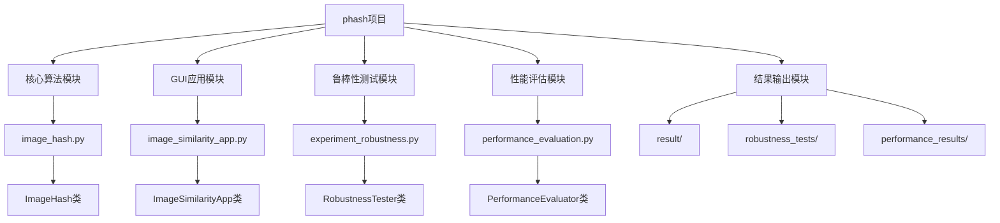
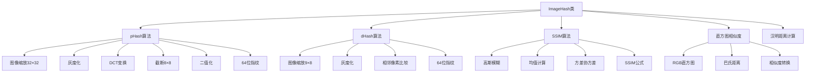
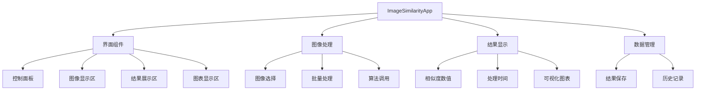
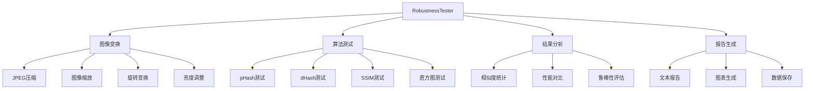
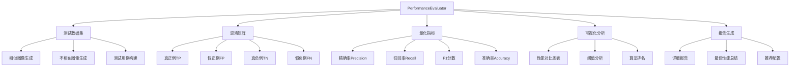
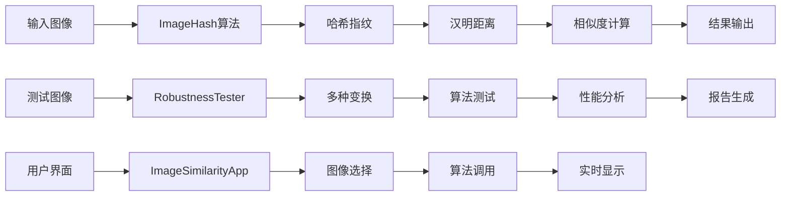

# pHash 图像相似度检测项目框架图

## 项目整体架构



## 核心算法模块详细结构



## GUI应用模块结构



## 鲁棒性测试模块结构



## 性能评估模块结构



## 数据流向图



## 文件结构图

```
phash/
├── image_hash.py              # 核心算法实现
├── image_similarity_app.py    # GUI应用
├── experiment_robustness.py   # 鲁棒性测试
├── ptest.txt                  # 测试数据
├── result/                    # 结果输出目录
│   ├── 78.txt
│   ├── lubangxing.txt
│   └── 结论.txt
└── robustness_tests/          # 鲁棒性测试结果
    ├── image7_*.jpg          # 变换后的测试图像
    └── report/               # 测试报告
        ├── robustness_report.txt
        └── *.png            # 对比图表
```

## 算法性能对比

| 算法 | 精确率 | 召回率 | F1分数 | 速度 | 鲁棒性 | 适用场景 |
|------|--------|--------|--------|------|--------|----------|
| pHash | 高 | 高 | 高 | 快 | 强 | 通用图像识别 |
| dHash | 中 | 中 | 中 | 最快 | 中 | 快速筛选 |
| SSIM | 最高 | 最高 | 最高 | 慢 | 强 | 精确比较 |
| 直方图 | 中 | 低 | 中 | 快 | 弱 | 颜色相似 |

## 量化指标说明

### 🎯 **混淆矩阵**
- **TP (真正例)**: 相似图像被正确识别为相似
- **FP (假正例)**: 不相似图像被错误识别为相似
- **TN (真负例)**: 不相似图像被正确识别为不相似
- **FN (假负例)**: 相似图像被错误识别为不相似

### 📊 **关键指标**
- **精确率 (Precision)**: TP / (TP + FP) - "判断为相似的图像中，真正相似的比例"
- **召回率 (Recall)**: TP / (TP + FN) - "所有相似图像中，被正确识别的比例"
- **F1分数**: 2 × (Precision × Recall) / (Precision + Recall) - 精确率和召回率的调和平均数
- **准确率 (Accuracy)**: (TP + TN) / (TP + TN + FP + FN) - 所有判断中正确的比例

## 技术栈

- **图像处理**: OpenCV, PIL
- **数值计算**: NumPy
- **GUI界面**: Tkinter
- **数据可视化**: Matplotlib
- **算法实现**: 自研SSIM, pHash, dHash
